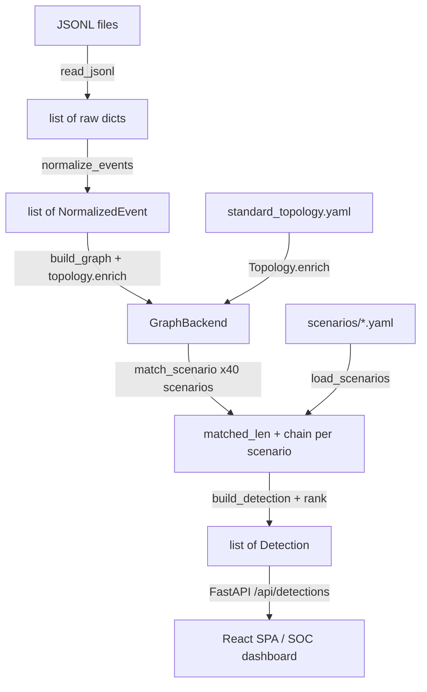

**English** | [Tiếng Việt](../vi/ARCHITECTURE.md)

# Augur — System Architecture

Related documents: [ENGINE.md](ENGINE.md) | [DATA_MODEL.md](DATA_MODEL.md) | [SCENARIO_FORMAT.md](SCENARIO_FORMAT.md) | [API.md](API.md) | [CONTRIBUTING.md](CONTRIBUTING.md)

---

## What Augur Does

Augur is a **deterministic, AI-free threat-hunting engine**. It ingests JSONL security logs from Windows,
Linux, and macOS endpoints, projects them onto a temporal knowledge graph, and evaluates how much of each
pre-authored attack scenario is already visible in the data. The answer is a ranked list of *detections*,
each carrying a `proximity` score — the fraction of the attack chain that has been observed — plus
ready-to-run KQL/Sigma queries for immediate follow-up hunting.

The defining constraint: **no LLM, no randomness, no wall-clock reads in the scoring path.** Identical
inputs always produce identical outputs, making detections auditable and reproducible.

---

## High-Level Data Flow

```
JSONL log files (one or more paths)
        │
        │  augur.ingest  ──  read_jsonl(path) → list[dict]
        │  Line-by-line reader; raises IngestError(line=N) on malformed JSON.
        ▼
list[dict]  (raw events, OS-specific fields intact)
        │
        │  augur.normalize  ──  normalize_events(raws) → list[NormalizedEvent]
        │  source_type registry dispatches to the right OS normalizer.
        │  Absent source_type → legacy Windows path (back-compat).
        ▼
list[NormalizedEvent]  (single canonical dataclass; engine kinds ∈ {process_create, image_load, behavior};
                        dns_query / network_connect also exist but are engine-blind — see IOC seam below)
        │
        │  augur.topology  ──  Topology.enrich(hostname) → (Zone, Criticality)
        │  augur.graph.builder  ──  build_graph(events, topology, backend)
        │  Iterates events sorted by timestamp. Creates nodes + edges; host zone/criticality
        │  comes exclusively from topology (event-supplied values are ignored).
        ▼
GraphBackend  (temporal knowledge graph)
        │                    ┌─ NetworkXBackend  (default — in-memory, zero infra)
        │  [ABC]             └─ Neo4jBackend     (opt-in — AUGUR_BACKEND=neo4j)
        │
        │  augur.engine.runner  ──  run_engine(backend, scenarios, min_proximity)
        │    For each scenario → match_scenario() → longest-valid-prefix DFS
        │    → build_detection() → rank()
        ▼
list[Detection]  (ranked by proximity desc, severity desc, recency desc)
        │
        │  augur.api  ──  FastAPI application
        │  GET /api/detections  →  JSON array (private sort fields stripped)
        │  React SPA served from frontend/dist (SPA fallback)
        ▼
Browser dashboard (dark SOC console)
```

---

## Pipeline Stages

### 1. Ingest — `augur/ingest/jsonl.py`

`read_jsonl(path)` opens a file and iterates it line by line. Blank lines are silently skipped. Any line
that is not valid JSON raises `IngestError` carrying the line number, so the caller knows exactly where the
problem is. The function returns `list[dict]` — raw dicts with no field validation. Validation is
intentionally deferred to the normalizer.

### 2. Normalize — `augur/normalize/`

The normalizer layer converts raw OS-specific dicts to a single `NormalizedEvent` dataclass. It uses a
**source_type registry** (`normalize/registry.py`) to dispatch each raw event to the correct OS normalizer:

| `source_type` value | Normalizer module | OS | Key event types handled |
|---------------------|-------------------|----|-------------------------|
| `windows_sysmon` | `normalize/windows_sysmon.py` | Windows | event_id 1 (process_create), 7 (image_load), `"edr"` (behavior) |
| `linux_auditd` | `normalize/linux_auditd.py` | Linux | type EXECVE (process_create), SYSCALL (image_load), EDR (behavior) |
| `macos_esf` | `normalize/macos_esf.py` | macOS | ES_EVENT_TYPE_NOTIFY_EXEC (process_create), ES_EVENT_TYPE_NOTIFY_MMAP (image_load) |
| absent / `None` | `windows_sysmon.normalize` | Windows | Legacy fallback — preserves back-compatibility |

If `source_type` is present but not in the registry, `normalize_event()` raises `ValueError` immediately.

All three normalizers map their inputs to the same `NormalizedEvent` dataclass (defined in
`normalize/model.py`). Key fields:

- **Provenance:** `source_type`, `os_family`, `raw_event_type` — carried through for traceability; the
  engine never reads these fields.
- **Event kind:** `kind` — the graph builder branches on `process_create`, `image_load`, `behavior`. The
  IOC-overlay kinds `dns_query` and `network_connect` also flow through but are deliberately *engine-blind*
  (the builder drops them — see [Engine-blind fields and kinds](#engine-blind-fields-and-kinds-the-ioc-overlay-seam)).
- **Network / IOC fields (engine-blind):** `domain`, `dest_ip`, `dest_port` — optional, inert, in no
  criteria field map; carried only for the read-only IOC overlay.
- **Process fields:** `process_guid`, `process_name`, `process_path`, `command_line`,
  `parent_process_guid`, `parent_process_name`, `integrity_level`, `user_sid`, `hashes`.
- **Image-load fields:** `image_loaded`, `extension`, `signed`, `signature_vendor`, `is_injected`,
  `api_hooking_detected`, `hooked_functions`.
- **Behavior fields:** `behavior`, `target`, `granted_access`, `reason`.

`ecs.py` is a thin back-compat shim that re-exports `normalize_events` from the registry.

### 3. Topology — `augur/topology/network.py`

`load_topology(path)` reads `standard_topology.yaml` (bundled inside the package) into a validated pydantic
model. `Topology.enrich(hostname)` does a case-insensitive lookup and returns `(Zone, Criticality)`.

**Topology is the sole source of truth for zone and criticality.** Any `zone` field present in a raw log
event is ignored when evaluating spatial constraints. This makes the engine robust to misconfigured or
attacker-manipulated telemetry. Hosts not in the topology file receive `(Zone.Unknown,
Criticality.UNKNOWN)` — which causes them to fail every spatial gate automatically.

### 4. Graph Construction — `augur/graph/builder.py`

`build_graph(events, topology, backend)` populates the `GraphBackend` from a sorted list of
`NormalizedEvent` objects. It calls `backend.reset()` first, then for each event:

- **process_create** → creates a `ProcessNode`; adds a `RUNS_ON` edge to the host; if
  `parent_process_guid` is present, adds a `SPAWNED` edge from parent to child.
- **image_load** → creates a `FileNode` with a unique ID `{process_guid}|{image_loaded}|{seq}` (sequence
  counter handles repeated loads of the same DLL by the same process); adds a `LOADED` edge from process to
  file.
- **behavior** → adds a self-referential `EXHIBITED` edge on the process node (src == dst ==
  `process_guid`) carrying `behavior`, `target`, `granted_access`, and `reason` as edge attributes.

Hosts are created lazily: on the first event referencing a given hostname, `ensure_host()` calls
`topology.enrich()` and creates a `HostNode`. Subsequent events for the same host reuse the cached node.

### 5. GraphBackend — `augur/graph/interface.py`

The `GraphBackend` abstract base class defines the contract that both implementations must satisfy:

```python
class GraphBackend(ABC):
    def add_host(self, host: HostNode) -> None
    def add_process(self, proc: ProcessNode) -> None
    def add_file(self, f: FileNode) -> None
    def add_edge(self, src_id, dst_id, edge_type, timestamp, **attrs) -> None
    def find_nodes(self, node_type, predicate) -> list[Node]
    def edges_from(self, node_id, edge_type=None) -> list[Edge]
    def host_of(self, node_id) -> HostNode | None
    def get_node(self, node_id) -> Node | None
    def reset(self) -> None
```

**Ordering contract:** both `find_nodes` and `edges_from` must return results sorted by `(timestamp,
element_id)`. Both current implementations satisfy this. Violating it would break determinism.

**NetworkXBackend** (`graph/networkx_backend.py`) wraps a `networkx.MultiDiGraph`. It is the default for
all tests and the demo command. Zero external dependencies beyond the `networkx` package.

**Neo4jBackend** (`graph/neo4j_backend.py`) uses Cypher queries and `MERGE` for idempotent node creation.
Activated by `AUGUR_BACKEND=neo4j`. Requires `uv sync --extra neo4j` and a running Neo4j instance
(provided by `docker-compose.yml` on ports 7474/7687). The integration tests in
`tests/test_neo4j_backend.py` are guarded by `AUGUR_NEO4J_TEST=1` and are always skipped in the default
`uv run pytest` run.

Because the engine depends only on the ABC, switching from NetworkX to Neo4j (or any future backend)
requires zero changes to the matching or scoring code.

### 6. Engine — `augur/engine/`

The engine is three modules wired together by `runner.py`:

- **`criteria.py`** — `match_value()` and two predicate functions (`node_matches`, `behavior_edge_matches`)
  that evaluate scenario criteria against graph nodes and EXHIBITED edges. Five criterion operators:
  literal equality, `regex`, `equals`, `in`, `exists`.
- **`matcher.py`** — `match_scenario(scenario, backend)` performs a deterministic depth-first search over
  pre-computed, sorted candidate sets to find the **longest contiguous prefix** of scenario steps that is
  satisfied by the graph. Returns `(matched_len, chain)`. See [ENGINE.md](ENGINE.md) for the full
  algorithm.
- **`scoring.py`** — `build_detection()` constructs a `Detection` dataclass from the matched chain.
  `rank()` filters by `min_proximity` and sorts by `(-proximity, -severity_rank, -latest_ts_epoch)`.

`runner.py::run_engine(backend, scenarios, min_proximity)` drives the loop: for every scenario, call
`match_scenario`, build a detection if `matched_len > 0`, then rank.

### 7. API and Frontend — `augur/api/app.py`

FastAPI application serving:

- **Data routes** (RBAC-gated): `GET /api/detections`, `/api/scenarios`, `/api/topology`,
  `/api/metrics`.
- **Auth routes**: `/api/auth/{login,logout,me,change-password,sessions}`.
- **Alerting routes**: `/api/alerts`, `/api/alerts/{id}`, `/api/alerts/{id}/ack`,
  `/api/alerts/config`, `/api/alerts/scan`.
- **Generative routes** (opt-in): `/api/generate`, `/api/candidates`.
- **Analyst-layer routes** (read-only, additive — see [Analyst Layer](#analyst-layer--read-only-soc-decision-support)):
  `GET /api/momentum`, `/api/host_risk`, `/api/coverage_gaps`, `/api/navigator_layer`, `/api/playbook`,
  `/api/detection_health`, `/api/incidents`, `/api/incident_response`, `/api/incident_report/{id}`;
  `POST /api/drill`, `/api/dispatch`, `/api/ioc_match`, `/api/ioc_extract`. All new routes register
  **before the SPA catch-all** and follow the established analyst-layer pattern (viewer-gated, LRU-cached,
  `ValueError` → 422). Full request/response shapes live in [API.md](API.md).
- **User management**: `/api/users/…`.
- **React SPA**: built output mounted from `frontend/dist` with SPA fallback for client-side routing.
  New analyst pages `/host-risk`, `/coverage-gaps`, `/drill`; the shared `DetectionCard` is enriched
  (next-step hunt, why-stalled, momentum sparkline, playbook panel). The console is PWA-installable and
  responsive.

`_public(d)` strips any Detection field whose name starts with `_` (`_latest_ts`, `_latest_ts_epoch`,
`_severity_rank`) before serialising to JSON. These private fields exist only for sorting.

CSRF protection uses a double-submit pattern on mutating requests. Authentication uses server-side session
cookies (`augur_session`, HttpOnly / SameSite=Strict, Secure in production), argon2id password hashing,
and an SQLite-backed session/user store. RBAC has three roles: viewer < analyst < admin.

---

## Platform Subsystems

These subsystems sit **around** the pure detection engine. The zero-engine-change invariant means they
never modify `engine/`, `graph/`, or `normalize/`.

### Connectors — `augur/connectors/`

Implements `Source` and `Sink` protocols. Sources pull log data into the pipeline; Sinks receive ranked
detections and route them downstream.

| Category | Implementations |
|----------|----------------|
| Sources | `JsonlSource`, `DirectorySource`, `StdinSource`, `HttpSource` |
| Sinks | `StdoutSink`, `JsonlFileSink`, `WebhookSink`, `SlackSink`, `JiraSink`, `CortexXsoarSink` |

`run_hunt` wires a source to the engine and fans out results to all configured sinks.

### Auth — `augur/auth/`

Server-side session management: cookie-based sessions, argon2id password hashing, SQLite stores for users
/ sessions / auth events, in-process rate limiting and lockout, fail-closed `AUGUR_SECRET_KEY` requirement
in production. No default admin password — must be bootstrapped via env vars or the `augur.useradmin` CLI.

### Alerting — `augur/alerting/`

Stateful alert lifecycle on top of the engine's ranked detections. Deduplicates on `(scenario_id, hosts)`
tuple. Bands: WATCH (proximity ≥ 0.6), HIGH (≥ 0.8), CONFIRMED (= 1.0). Each band crossing fires a
notify-once notification via the configured Sinks. Alerts progress open → acknowledged. An autonomous
background monitor (enabled by `AUGUR_MONITOR_ENABLED=1`) polls for new log data and runs the engine
continuously. A read-only SOC inbox UI surfaces the alert feed.

### FP Tuning / Allowlist — `augur/tuning/`

A deterministic, post-engine **policy layer** for false-positive control: a SOC can suppress or downgrade
known-good detections without ever touching the engine. `apply_allowlist(detections, entries)` is a pure
function wired into exactly the two human-facing surfaces — the `GET /api/detections` serve path and the
alerting detection→alert path. With an **empty allowlist it is a provable no-op** (the analysis surfaces —
health, coverage, momentum, campaign, metrics — always see raw engine reality). An entry is an AND of
optional predicates (scenario / technique / host / zone / process·command·image regex / corpus-time window)
plus an action: **SUPPRESS** (mute) or **DOWNGRADE** (lower the alerting band — proximity is never mutated)
and a **required reason**. Suppression is never silent: everything muted is counted and attributed to its
entry in an always-visible "Tuned out" ledger (`GET /api/tuning/ledger`). The feedback loop is human-gated:
an analyst triages an alert as a false positive, the system returns a pre-filled allowlist draft (with an
advisory rarity baseline hint — common ≠ benign), and the analyst reviews and saves. Deterministic: the match
path has no wall-clock; entry expiry is resolved at the store boundary. CRUD via `/api/tuning` (viewer-read /
analyst-write / CSRF); console page `/tuning`.

### Generative — `augur/generative/` (opt-in `[ai]` extra)

An LLM (`claude-opus-4-8` via the Anthropic API) proposes candidate mutation scenarios — novel variants or
permutations of the existing library. A **deterministic guardrail gauntlet** (schema validation → dedup →
fires-on-benign FP-guard → detectability check) vets each candidate. A human approval gate is required
before any scenario enters the live library. Nothing is added automatically.

This is the only LLM component in Augur; it operates completely outside the detection hot path. The engine
itself never makes a generative call.

### Simulator — `augur/simulator/`

A deterministic multi-OS log generator used for PoC testing and sample-data generation. Per-OS emitter
profiles mirror the normalizer structure (Windows Sysmon / Linux auditd / macOS ESF). `realism.py`
provides technique-accurate command lines and real binary paths. CLI: `python -m augur.simulator --batch`
or `--stream`. The simulator is explicitly a PoC stand-in for real machine telemetry; its synthetic logs
are not equivalent to production data.

### Metrics — `augur/metrics/`

Evaluation harness: MITRE ATT&CK tactic/technique coverage, false-positive rate on the simulator benign
corpus, per-scenario detectability. CLI: `python -m augur.metrics`. Detectability is 100% by construction
(scenarios are authored to be synth-friendly); FP rate 0.0 is measured only on the simulator-generated
benign corpus, not on real telemetry.

**Risk-validation / false-negative-boundary harness.** `metrics/mutations.py` provides pure, deterministic
trace mutators (`drop_step`, `stretch_temporal`, `relocate_zone`, `relink_host`) that perturb a scenario's
positive synthetic trace along each engine gate axis. `metrics/robustness.py::detection_robustness` mutates
those traces and asserts the engine degrades to the **schema-derived expected proximity** — proving the
temporal / spatial / link gates correctly *reject* (the false-negative boundary), without ever changing the
engine: the mutators only perturb the input, then the unchanged read-only pipeline is run. CLI gate:
`python -m augur.metrics --fail-on-robustness [--all-steps]` (exits non-zero on any failed mutation;
`--all-steps` sweeps stretch/relink over every prefix position). A non-gating `criteria_overlap_diagnostic`
additionally surfaces a precision property of the scenario library honestly. Robustness is 100% on the
current library — a construction-integrity gate, not a real-world FN-rate claim.

---

## Analyst Layer — read-only SOC decision support

A SOC-analyst feature layer sits at the **API/app boundary** (plus a pair of engine-adjacent read-only
helpers). Every piece below is **additive and read-only**: it re-runs or aggregates over the *existing*
deterministic engine output, the simulator, the scenario library, or the topology. None of it touches the
longest-valid-prefix matcher or the scoring path — that code is byte-identical and a determinism guard test
proves it. This is the key architectural point: an entire analyst layer was added **without changing the
engine**.

| Component | Endpoint | What it does | Reads / reuses |
|-----------|----------|--------------|----------------|
| `engine/diagnose.py` | (engine-adjacent) | Explainable near-misses: read-only diagnosis of *why* a partial detection stalled. Re-runs the matcher's standalone gate helpers for the next step and reports the failing gate + delta. **Not in the scoring path.** | Graph backend, matcher gate helpers |
| `engine/scoring.py` `build_detection` | — | Additively enriches `missing_steps` with criteria + temporal info (next-step hunting). Proximity / `matched_len` / ranking are **unchanged**. | Matched chain |
| `api/momentum.py` | `GET /api/momentum` | Proximity momentum: an honest rising / flat / falling series built by running the read-only windowed engine over the *same* corpus at growing `to` bounds. No fabricated history, no persistence. | Per-window `lru_cache` of the read-only engine |
| `api/host_risk.py` | `GET /api/host_risk` | Host Risk Board: Σ(proximity × criticality × severity) per host. Read-only aggregation. | Detections + topology |
| `metrics/coverage.py` `coverage_gap_matrix` | `GET /api/coverage_gaps` | Tactics × OS coverage-gap grid. | Scenario library + topology |
| `api/navigator.py` | `GET /api/navigator_layer` | MITRE ATT&CK Navigator v4.5 layer export (detections / coverage). Pure serialization. | Detections / coverage |
| `api/drill.py` | `POST /api/drill` | Purple-team drill: the deterministic **simulator** generates a benign feed with a chosen scenario injected, then the **existing read-only engine pipeline** (normalize → build_graph → run_engine) runs over it. Deterministic — fixed seed + fixed base-time, never `now`. | Simulator + unchanged engine pipeline |
| `response/playbook.py` | `GET /api/playbook`, `POST /api/dispatch` | Response Playbooks: a standard tactic-derived runbook, plus a dispatch that emits the detection through the existing connector **Sinks** (infra-free preview by default; real sinks only via the persisted alert sink config). | Detections + connector Sinks |
| `api/detection_health.py` | `GET /api/detection_health` | Detection Health: per-scenario liveness over the corpus — `FIRING` / `PARTIAL` / `SILENT` / `NEVER`, computed from a growing-window sweep of the read-only windowed engine. Honest — health is over *this* corpus, not a production claim. | `windowed_detections` wrapper + cached feed |
| `api/incidents.py` | `GET /api/incidents` | Incident clustering: deterministic connected-components correlation of detections into incidents (edges = **shared host** OR **shared technique**; temporal adjacency is a label-only context signal, never a merge edge). Pure-stdlib union-find — no networkx. | Public detection dicts + scenario techniques + topology |
| `api/incident_response.py` | `GET /api/incident_response` | Consolidated response: per-incident union of the standard `response/playbook.py` runbooks, merged and de-duplicated with per-action provenance. | Cached incidents + `build_playbook` |
| `api/incident_report.py` | `GET /api/incident_report/{id}` (`?format=markdown`) | Post-incident report: a pure fold over the cached incident + response dicts (JSON body + Markdown export), closing the IR loop. Deterministic — no `now()` stamp. | Cached incident + response payloads |

`api/drill.py` is the clean example of the engine-purity story: it feeds the *same* engine fresh synthetic
input and changes nothing inside it. `response/playbook.py` reuses the connector Sink layer rather than
adding a new output path. Together these subsystems demonstrate that proactive analyst tooling — momentum,
host risk, coverage gaps, ATT&CK Navigator export, purple-team drills, and response playbooks — can be
built entirely from read-only reuse of the deterministic core.

The incident chain is the same story extended into a full **detect → cluster → respond → report** loop:
`incidents.py` correlates the *existing* detections into incidents with a pure-stdlib union-find (no graph
library, no engine pass), `incident_response.py` folds each cluster into the union of the standard
per-scenario playbooks, and `incident_report.py` assembles a deterministic hand-off artifact by pure
selection over the two cached payloads. Each stage consumes only the public dicts the stage before it
produced — no recomputation, no `now()` — so the whole IR chain inherits the engine's determinism.

### Engine-blind fields and kinds (the IOC overlay seam)

The IOC threat-intel overlay (`api/ioc.py` / `api/ioc_extract.py`) now matches hash, domain, IP, CIDR, and
IPv6 indicators across all three OSes — backed by new `NormalizedEvent` fields (`hashes`, `domain`,
`dest_ip`) and two new event kinds (`dns_query`, `network_connect`) emitted by the normalizers and the
simulator. This was added **without touching the engine, matcher, scoring, or graph code** by an
intentional *engine-blind field/kind recipe*:

- The new fields and kinds flow through `normalize` → `build_graph` → `engine` like any other event, **but**
  `build_graph` only branches on `process_create` / `image_load` / `behavior` — the new `dns_query` and
  `network_connect` kinds fall through to a no-op and create **zero nodes and zero edges**.
- The new fields (`domain`, `dest_ip`) appear in **no `criteria.py` field map**, so the matcher can never
  read them.

The result is that this telemetry is *structurally invisible* to the detection path — it exists solely so
the read-only IOC overlay has something to match against. The whole IOC arc proves the same invariant as the
analyst layer: capability grows around a frozen core, and the engine/matcher/scoring/graph code is
byte-identical throughout.

---

## Scenario Library

**40 scenarios** across all 14 ATT&CK tactics (reconnaissance through impact). OS-prefixed IDs:

| Prefix | OS | Count | Canonical anchor |
|--------|-----|-------|-----------------|
| `SCEN-WIN-*` | Windows | 19 | `SCEN-WIN-001` — LSASS comsvcs MiniDump |
| `SCEN-LNX-*` | Linux | 13 | `SCEN-LNX-001` — cron backdoor persistence |
| `SCEN-MAC-*` | macOS | 8 | `SCEN-MAC-001` — osascript stager |
| `SCEN-CLD-*` | Cloud (endpoint telemetry) | stub | `SCEN-CLD-001` — AWS key theft |

Scenarios are YAML files organised by tactic folder under `scenarios/`. Each has at least one
`mitre_mapping` and one KQL or Sigma `validation_query`. The `os_family` field in `scenario_metadata`
(default: `"windows"`) documents the target platform. The engine does not filter scenarios by OS — every
scenario is evaluated against every event in the graph.

---

## Topology and Zones

`standard_topology.yaml` (bundled at `src/augur/topology/`) lists the known hosts with their IP addresses,
OS, zone, and criticality. `Topology.enrich(hostname)` returns the zone and criticality for a given
hostname. Unknown hosts always get `(Zone.Unknown, Criticality.UNKNOWN)`.

Available zones: `DMZ`, `Internal_Server`, `User_Endpoint`, `Cloud_SaaS`, `Active_Directory`, `Unknown`.

Severity values: `LOW`, `MEDIUM`, `HIGH`, `CRITICAL` (with integer ranks 0–3 used for sorting).

---

## Backend Selection and Configuration

`pipeline._select_backend()` reads `AUGUR_BACKEND`:

```
AUGUR_BACKEND not set (or any value other than "neo4j")
    → NetworkXBackend()   [default — infra-free, used in all tests]

AUGUR_BACKEND=neo4j
    → Neo4jBackend(uri=NEO4J_URI, user=NEO4J_USER, password=NEO4J_PASSWORD)
      [requires running Neo4j; see docker-compose.yml]
```

`pipeline.build_backend(paths, topology, backend=None)` loads and normalizes events from all paths, sorts
by timestamp, calls `build_graph`, and returns the populated backend.

---

## Data-Flow Mermaid Diagram



---

## Generative Seam (Phase 2)

The LLM generative module is **opt-in** and out-of-band. Its only interaction with the deterministic engine
is via the filesystem: it writes schema-valid YAML files to a staging directory; a human reviewer promotes
approved candidates to `scenarios/`; the next engine run picks them up via `load_scenarios()`. The engine
never calls the LLM and the LLM never calls the engine.

```
[augur.generative]
    │  proposes candidate YAML files
    ▼
staging/  ──(human review + guardrail gauntlet)──►  scenarios/*.yaml
                                                          │
                                                     load_scenarios()
                                                          │
                                                   [unchanged engine]
```

Schema validation (`extra=forbid`, regex compilation, step ordering, step-ID contiguity) acts as a
type-safe firewall. Invalid LLM output raises `ValueError` in the loader and never reaches the matcher.

---

## Invariants

1. **Determinism.** No wall-clock reads, no randomness, no hash-dependent iteration order in the engine.
   Candidates are always sorted by `(timestamp, element_id)` before DFS.
2. **Infra-free default tests.** `uv run pytest` requires no running services. Neo4j and AI extras are
   opt-in (`AUGUR_NEO4J_TEST=1`, `uv sync --extra ai`).
3. **Topology is authoritative.** Event `zone` fields are never used for constraint evaluation.
4. **Schema strictness.** All pydantic models use `extra=forbid`. Unknown fields in scenario YAML raise
   `ValueError` at load time.
5. **Zero engine changes from platform subsystems.** Connectors, auth, alerting, generative, simulator,
   and metrics never import from `engine/`, `matcher.py`, or `scoring.py` in a way that modifies their
   behaviour. The engine is a pure function of `(backend, scenarios, min_proximity)`.
6. **Additive, read-only analyst layer.** The entire SOC-analyst layer (momentum, host risk, coverage
   gaps, Navigator export, purple-team drill, response playbooks, detection health, the incident
   detect→cluster→respond→report chain, the IOC threat-intel overlay, `engine/diagnose.py`, the enriched
   `build_detection`) sits at the API/app boundary or as engine-adjacent read-only helpers. The new IOC
   telemetry (`dns_query` / `network_connect` kinds, `domain` / `dest_ip` fields) is structurally
   engine-blind. The longest-valid-prefix scoring path is **byte-identical** — proven by a determinism
   guard test, and the robustness harness proves the gates reject correctly.

---

## Design Decisions (Rationale)

The load-bearing structural choices, and *why* they were made:

- **Python as the primary language.** Chosen for the ingest → normalize → graph → engine → API stack for
  velocity and ecosystem fit. The stage boundaries are kept clean so that, *if* performance ever demands it,
  the hot path can be offloaded **without a rewrite** — either by pushing graph matching down into Cypher
  inside Neo4j, or by extracting the high-volume ingest/normalize stage into a Go/Rust service behind the
  existing event contract. (A Go collector ↔ Python engine gRPC slice in `services/` demonstrates this seam.)

- **A deliberately modular monolith — *not* microservices.** Augur ships as a single deployable, but is
  built *service-ready*: clean module boundaries (`ingest`/`normalize`/`graph`/`engine`/`api`/…), an
  abstract `GraphBackend`, and the connector layer below. We extract a module into its own service **only
  when an explicit trigger fires** — throughput beyond one process, a stage needing independent horizontal
  scaling, separate team ownership, a justified polyglot rewrite of a hot path, or an isolation/security
  domain (the opt-in generative LLM is the natural first candidate to isolate). Extracting on principle,
  before a trigger, is avoided. This keeps the system simple today and the path to distribution open.

- **A pluggable connector layer (Sources & Sinks).** Ingestion and output are decoupled from the engine via
  `Source` (pull/receive raw events) and `Sink` (push detections/findings) protocols, selected by config/env
  exactly like the `GraphBackend`. New log vendors (Splunk/Sentinel/Elastic) or destinations
  (Slack/Jira/XSOAR) are added **without touching the engine**. Today's `connectors/` package implements
  JSONL/Directory/Stdin/Http sources and Stdout/JSONL/Webhook/Slack/Jira/Cortex-XSOAR sinks.

- **An analyst layer built by read-only reuse, not engine surgery.** The SOC-analyst features (proximity
  momentum, host-risk board, coverage-gap matrix, ATT&CK Navigator export, purple-team drill, response
  playbooks, explainable near-misses) were all added at the API/app boundary or as engine-adjacent
  read-only helpers — re-running, aggregating, or serializing the *existing* engine output, simulator,
  scenarios, and topology. The purple-team drill feeds the *same* deterministic engine fresh synthetic
  input; dispatch reuses the connector Sinks. Nothing inside the matcher or scoring path moved. This is the
  thesis of the architecture in miniature: a useful proactive product grows **around** a frozen, auditable
  core. See [Analyst Layer](#analyst-layer--read-only-soc-decision-support).

- **The engine stays pure (the overriding invariant).** Every subsystem above is built so the deterministic
  scoring path never changes — see [Invariants](#invariants).

---

## Quick-Start Commands

```bash
uv sync                                          # install dependencies
uv run pytest -q                                 # ~1164 passed, 3 skipped
python -m augur.demo --no-serve                  # headless engine run
python -m augur.demo                             # engine + dashboard on :8000
python -m augur.demo --logs path/to/logs.jsonl --min-proximity 0.20
AUGUR_BACKEND=neo4j python -m augur.demo         # Neo4j backend (needs docker-compose up)
```

Make shortcuts: `make install` / `make test` / `make engine` / `make demo` / `make up` (docker-compose).

## Real-data capability (tag-via-registry)

Augur validates against real public captures without forking any read-path. The mechanism is
**tag-via-registry**: a prep step (`scripts/fetch_real_datasets.py --tag`) writes
`datasets/real/<name>/tagged.jsonl` where every real OTRF Sysmon record gains
`"source_type": "windows_sysmon_real"`. The normalization registry already maps that key to
`normalize/windows_sysmon_real.py`, so every existing read-path — `load_normalized`, `build_backend`,
`windowed_detections`, IOC, rarity, timeline, pivot — dispatches correctly with **no per-route change**.
Unmodeled Sysmon EIDs normalize to `None` and are dropped cleanly.

- **Scenarios.** The real scenario lives in `scenarios_real/` (never auto-merged into
  `default_scenarios()`, which would break the synthetic synth-gate). `demo --real` loads
  `default_scenarios() + load_scenarios("scenarios_real")` so the synthetic library stays visible
  alongside `SCEN-REAL-WIN-T1003-001`.
- **Topology.** The capture's authoritative topology lives beside the dataset
  (`datasets/real/topology_otrf_theshire.yaml`); `Topology.enrich` remains the sole zone/criticality
  source. Unknown hosts still enrich to Unknown/UNKNOWN and fail the spatial gate — the gate is not weakened.
- **`create_app`.** Optional `topology`/`scenarios` params (default to the synthetic defaults, with
  `AUGUR_TOPOLOGY`/`AUGUR_SCENARIOS_DIR`/`AUGUR_SCENARIOS_EXTRA_DIR` env fallback for `--reload`'s factory
  mode). The default path is byte-identical to the synthetic console.
- **Honesty.** `/api/health` serves a `real_data` flag (default false) driving a read-only Dashboard
  banner; the IOC overlay swaps its synthetic-RFC-5737 IP clause for an honest real-telemetry statement when
  a real feed is loaded. Both are off by default.

---

## Streaming / windowed graph (opt-in, OFF by default)

The default `NetworkXBackend` accumulates every event forever. For sustained streaming ingest,
`src/augur/streaming/graph.py`'s `StreamingGraph` driver holds a **bounded rolling time window**:
it appends each batch via `ingest_events` (the upsert path `build_graph` was refactored onto, so
the one-shot and streaming paths run byte-identical construction code) and then evicts everything
older than `max_event_ts_seen − window` via `NetworkXBackend.prune_before`.

- **Opt-in / byte-identical.** `window=None` (the default) ⇒ `prune_before` is never called ⇒ the
  resident graph equals a one-shot `build_graph` of the concatenated events, node-for-node and
  edge-for-edge. The whole engine/scoring/detection path is untouched (the engine reads
  `sg.backend` exactly as today).
- **Determinism, no wall-clock.** The eviction cutoff derives ONLY from ingested event timestamps
  (`max_ts − window`), never `now()`. An AST guard locks this (`tests/test_no_wallclock_streaming.py`).
- **Eviction capability, not ABC.** `prune_before` lives on a separate `EvictableBackend` Protocol
  (`graph/eviction.py`), so the `GraphBackend` ABC is unchanged and `Neo4jBackend` is not forced to
  implement it. v1 windowing is NetworkX-only; a non-evictable backend with a finite window raises.
- **Eviction semantics.** Process/File nodes with `timestamp < cutoff` are removed (their incident
  edges drop with them); any remaining edge with `timestamp < cutoff` is removed too (stale
  `EXHIBITED`/`LOADED` edges carry their own event time); bare anchor nodes are dropped once isolated.
  Hosts are structural (no timestamp) and are never evicted.
- **Honest coverage tradeoff.** A window shorter than a scenario's max temporal span evicts a chain's
  early steps before it completes, so that detection is missed. `StreamingGraph` **refuses** such a
  window by default (`WindowTooSmallError`); `allow_lossy=True` opts in but surfaces a structured
  `LossyWindowWarning` on every `IngestReport`, so an absent detection under a too-small window is
  never silently read as "clean."

**v1 is a standalone, fully-tested capability.** Wiring the alerting monitor's per-scan *rebuild*
onto incremental `StreamingGraph` is a deferred performance migration (the seam is clean), not part
of v1.
