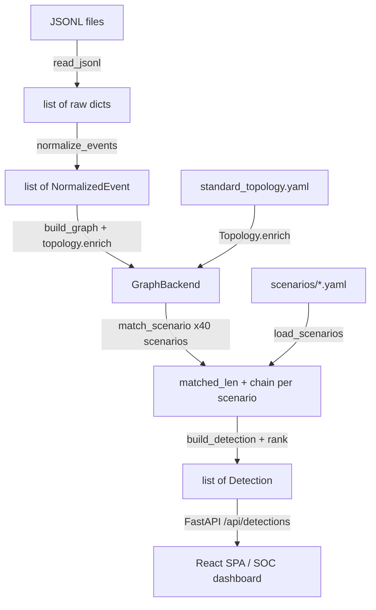

[Tiếng Anh](../en/ARCHITECTURE.md) | **Tiếng Việt**

# Augur — Kiến Trúc Hệ Thống

Tài liệu liên quan: [ENGINE.md](ENGINE.md) | [DATA_MODEL.md](DATA_MODEL.md) | [SCENARIO_FORMAT.md](SCENARIO_FORMAT.md) | [API.md](API.md) | [CONTRIBUTING.md](CONTRIBUTING.md)

---

## Augur Làm Gì

Augur là một **công cụ phát hiện mối đe dọa hoàn toàn tất định, không sử dụng AI**. Nó tiếp nhận các tệp nhật ký bảo mật JSONL từ các thiết bị đầu cuối chạy Windows, Linux và macOS, ánh xạ chúng lên một đồ thị tri thức theo thời gian, rồi đánh giá mức độ hiện diện của mỗi kịch bản tấn công đã được soạn thảo trước trong dữ liệu. Kết quả là một danh sách các *phát hiện* được xếp hạng, mỗi phát hiện mang điểm `proximity` — tỷ lệ phần trăm của chuỗi tấn công đã được quan sát — cùng với các truy vấn KQL/Sigma sẵn sàng chạy để hỗ trợ điều tra ngay lập tức.

Ràng buộc cốt lõi: **không LLM, không ngẫu nhiên, không đọc đồng hồ thực trong đường dẫn tính điểm.** Đầu vào giống nhau luôn cho ra đầu ra giống nhau, giúp các phát hiện có thể kiểm toán và tái hiện được.

---

## Luồng Dữ Liệu Tổng Quan

```
JSONL log files (one or more paths)
        │
        │  augur.ingest  ──  read_jsonl(path) → list[dict]
        │  Line-by-line reader; raises IngestError(line=N) on malformed JSON.
        ▼
list[dict]  (raw events, OS-specific fields intact)
        │
        │  augur.normalize  ──  normalize_events(raws) → list[NormalizedEvent]
        │  source_type registry dispatches to the right OS normalizer.
        │  Absent source_type → legacy Windows path (back-compat).
        ▼
list[NormalizedEvent]  (single canonical dataclass; engine kinds ∈ {process_create, image_load, behavior};
                        dns_query / network_connect also exist but are engine-blind — see IOC seam below)
        │
        │  augur.topology  ──  Topology.enrich(hostname) → (Zone, Criticality)
        │  augur.graph.builder  ──  build_graph(events, topology, backend)
        │  Iterates events sorted by timestamp. Creates nodes + edges; host zone/criticality
        │  comes exclusively from topology (event-supplied values are ignored).
        ▼
GraphBackend  (temporal knowledge graph)
        │                    ┌─ NetworkXBackend  (default — in-memory, zero infra)
        │  [ABC]             └─ Neo4jBackend     (opt-in — AUGUR_BACKEND=neo4j)
        │
        │  augur.engine.runner  ──  run_engine(backend, scenarios, min_proximity)
        │    For each scenario → match_scenario() → longest-valid-prefix DFS
        │    → build_detection() → rank()
        ▼
list[Detection]  (ranked by proximity desc, severity desc, recency desc)
        │
        │  augur.api  ──  FastAPI application
        │  GET /api/detections  →  JSON array (private sort fields stripped)
        │  React SPA served from frontend/dist (SPA fallback)
        ▼
Browser dashboard (dark SOC console)
```

---

## Các Giai Đoạn Pipeline

### 1. Tiếp Nhận — `augur/ingest/jsonl.py`

`read_jsonl(path)` mở một tệp và đọc từng dòng. Các dòng trắng được bỏ qua silently. Bất kỳ dòng nào không phải JSON hợp lệ sẽ ném ra `IngestError` kèm số dòng, giúp người gọi biết chính xác vị trí lỗi. Hàm trả về `list[dict]` — các dict thô không qua kiểm tra trường. Việc kiểm tra được cố ý để lại cho giai đoạn chuẩn hóa.

### 2. Chuẩn Hóa — `augur/normalize/`

Lớp chuẩn hóa chuyển đổi các dict thô theo định dạng riêng của từng hệ điều hành sang một dataclass `NormalizedEvent` duy nhất. Nó sử dụng một **registry theo source_type** (`normalize/registry.py`) để điều phối mỗi sự kiện thô đến trình chuẩn hóa đúng theo hệ điều hành:

| Giá trị `source_type` | Module chuẩn hóa | Hệ điều hành | Các loại sự kiện chính được xử lý |
|----------------------|------------------|--------------|-----------------------------------|
| `windows_sysmon` | `normalize/windows_sysmon.py` | Windows | event_id 1 (process_create), 7 (image_load), `"edr"` (behavior) |
| `linux_auditd` | `normalize/linux_auditd.py` | Linux | type EXECVE (process_create), SYSCALL (image_load), EDR (behavior) |
| `macos_esf` | `normalize/macos_esf.py` | macOS | ES_EVENT_TYPE_NOTIFY_EXEC (process_create), ES_EVENT_TYPE_NOTIFY_MMAP (image_load) |
| vắng mặt / `None` | `windows_sysmon.normalize` | Windows | Đường dự phòng legacy — giữ khả năng tương thích ngược |

Nếu `source_type` có mặt nhưng không nằm trong registry, `normalize_event()` ném ra `ValueError` ngay lập tức.

Cả ba trình chuẩn hóa đều ánh xạ đầu vào của mình sang cùng một dataclass `NormalizedEvent` (được định nghĩa trong `normalize/model.py`). Các trường chính:

- **Nguồn gốc:** `source_type`, `os_family`, `raw_event_type` — được giữ nguyên để truy vết; engine không bao giờ đọc các trường này.
- **Loại sự kiện:** `kind` — graph builder phân nhánh trên `process_create`, `image_load`, `behavior`. Các
  kind IOC-overlay `dns_query` và `network_connect` cũng chảy qua nhưng cố ý *ẩn với engine* (builder bỏ
  chúng — xem [Trường và kind ẩn với engine](#trường-và-kind-ẩn-với-engine-đường-nối-ioc-overlay)).
- **Trường mạng / IOC (ẩn với engine):** `domain`, `dest_ip`, `dest_port` — tùy chọn, trơ, không nằm trong
  field map tiêu chí nào; chỉ được mang theo cho lớp phủ IOC chỉ đọc.
- **Trường tiến trình:** `process_guid`, `process_name`, `process_path`, `command_line`, `parent_process_guid`, `parent_process_name`, `integrity_level`, `user_sid`, `hashes`.
- **Trường image-load:** `image_loaded`, `extension`, `signed`, `signature_vendor`, `is_injected`, `api_hooking_detected`, `hooked_functions`.
- **Trường behavior:** `behavior`, `target`, `granted_access`, `reason`.

`ecs.py` là một shim tương thích ngược mỏng tái xuất `normalize_events` từ registry.

### 3. Topology — `augur/topology/network.py`

`load_topology(path)` đọc `standard_topology.yaml` (được đóng gói bên trong package) vào một pydantic model đã được kiểm tra. `Topology.enrich(hostname)` thực hiện tra cứu không phân biệt chữ hoa/thường và trả về `(Zone, Criticality)`.

**Topology là nguồn sự thật duy nhất cho zone và criticality.** Bất kỳ trường `zone` nào có trong nhật ký thô đều bị bỏ qua khi đánh giá các ràng buộc không gian. Điều này giúp engine chống lại telemetry bị cấu hình sai hoặc bị kẻ tấn công thao túng. Các host không có trong tệp topology nhận `(Zone.Unknown, Criticality.UNKNOWN)` — khiến chúng tự động thất bại ở mọi cổng kiểm tra không gian.

### 4. Xây Dựng Đồ Thị — `augur/graph/builder.py`

`build_graph(events, topology, backend)` điền dữ liệu vào `GraphBackend` từ một danh sách `NormalizedEvent` đã được sắp xếp. Nó gọi `backend.reset()` trước, sau đó với mỗi sự kiện:

- **process_create** → tạo một `ProcessNode`; thêm cạnh `RUNS_ON` đến host; nếu `parent_process_guid` có mặt, thêm cạnh `SPAWNED` từ tiến trình cha đến tiến trình con.
- **image_load** → tạo một `FileNode` với ID duy nhất `{process_guid}|{image_loaded}|{seq}` (bộ đếm sequence xử lý các lần tải lặp lại của cùng một DLL bởi cùng một tiến trình); thêm cạnh `LOADED` từ tiến trình đến tệp.
- **behavior** → thêm một cạnh tự tham chiếu `EXHIBITED` trên node tiến trình (src == dst == `process_guid`) mang theo `behavior`, `target`, `granted_access`, và `reason` dưới dạng thuộc tính cạnh.

Các host được tạo lazily: khi sự kiện đầu tiên tham chiếu đến một hostname, `ensure_host()` gọi `topology.enrich()` và tạo một `HostNode`. Các sự kiện tiếp theo của cùng host sẽ tái sử dụng node đã được cache.

### 5. GraphBackend — `augur/graph/interface.py`

Abstract base class `GraphBackend` định nghĩa hợp đồng mà cả hai cài đặt phải tuân thủ:

```python
class GraphBackend(ABC):
    def add_host(self, host: HostNode) -> None
    def add_process(self, proc: ProcessNode) -> None
    def add_file(self, f: FileNode) -> None
    def add_edge(self, src_id, dst_id, edge_type, timestamp, **attrs) -> None
    def find_nodes(self, node_type, predicate) -> list[Node]
    def edges_from(self, node_id, edge_type=None) -> list[Edge]
    def host_of(self, node_id) -> HostNode | None
    def get_node(self, node_id) -> Node | None
    def reset(self) -> None
```

**Hợp đồng về thứ tự:** cả `find_nodes` lẫn `edges_from` phải trả về kết quả được sắp xếp theo `(timestamp, element_id)`. Cả hai cài đặt hiện tại đều đáp ứng điều này. Vi phạm hợp đồng này sẽ phá vỡ tính tất định.

**NetworkXBackend** (`graph/networkx_backend.py`) bao bọc một `networkx.MultiDiGraph`. Đây là mặc định cho tất cả các bài kiểm tra và lệnh demo. Không có phụ thuộc bên ngoài ngoài package `networkx`.

**Neo4jBackend** (`graph/neo4j_backend.py`) sử dụng các truy vấn Cypher và `MERGE` để tạo node idempotent. Được kích hoạt bằng `AUGUR_BACKEND=neo4j`. Yêu cầu `uv sync --extra neo4j` và một phiên bản Neo4j đang chạy (được cung cấp bởi `docker-compose.yml` trên cổng 7474/7687). Các bài kiểm tra tích hợp trong `tests/test_neo4j_backend.py` được bảo vệ bởi `AUGUR_NEO4J_TEST=1` và luôn bị bỏ qua trong lần chạy `uv run pytest` mặc định.

Vì engine chỉ phụ thuộc vào ABC, việc chuyển từ NetworkX sang Neo4j (hoặc bất kỳ backend nào trong tương lai) không yêu cầu thay đổi gì trong mã khớp hoặc tính điểm.

### 6. Engine — `augur/engine/`

Engine gồm ba module được kết nối bởi `runner.py`:

- **`criteria.py`** — `match_value()` và hai hàm vị từ (`node_matches`, `behavior_edge_matches`) đánh giá các tiêu chí kịch bản so với các node và cạnh EXHIBITED trong đồ thị. Năm toán tử tiêu chí: so sánh bằng literal, `regex`, `equals`, `in`, `exists`.
- **`matcher.py`** — `match_scenario(scenario, backend)` thực hiện tìm kiếm theo chiều sâu tất định trên các tập ứng viên được sắp xếp trước để tìm **tiền tố liên tiếp dài nhất** của các bước kịch bản được thỏa mãn bởi đồ thị. Trả về `(matched_len, chain)`. Xem [ENGINE.md](ENGINE.md) để biết thuật toán đầy đủ.
- **`scoring.py`** — `build_detection()` xây dựng một dataclass `Detection` từ chuỗi đã khớp. `rank()` lọc theo `min_proximity` và sắp xếp theo `(-proximity, -severity_rank, -latest_ts_epoch)`.

`runner.py::run_engine(backend, scenarios, min_proximity)` điều khiển vòng lặp: với mỗi kịch bản, gọi `match_scenario`, xây dựng phát hiện nếu `matched_len > 0`, rồi xếp hạng.

### 7. API và Frontend — `augur/api/app.py`

Ứng dụng FastAPI phục vụ:

- **Các route dữ liệu** (kiểm soát RBAC): `GET /api/detections`, `/api/scenarios`, `/api/topology`, `/api/metrics`.
- **Các route xác thực**: `/api/auth/{login,logout,me,change-password,sessions}`.
- **Các route cảnh báo**: `/api/alerts`, `/api/alerts/{id}`, `/api/alerts/{id}/ack`, `/api/alerts/config`, `/api/alerts/scan`.
- **Các route sinh nội dung** (opt-in): `/api/generate`, `/api/candidates`.
- **Các route tầng phân tích** (chỉ đọc, mang tính bổ sung — xem [Tầng Phân Tích](#tầng-phân-tích--hỗ-trợ-quyết-định-soc-chỉ-đọc)):
  `GET /api/momentum`, `/api/host_risk`, `/api/coverage_gaps`, `/api/navigator_layer`, `/api/playbook`,
  `/api/detection_health`, `/api/incidents`, `/api/incident_response`, `/api/incident_report/{id}`;
  `POST /api/drill`, `/api/dispatch`, `/api/ioc_match`, `/api/ioc_extract`. Tất cả các route mới đăng ký
  **trước SPA catch-all** và tuân theo khuôn mẫu tầng-phân-tích đã thiết lập (giới hạn viewer, LRU-cache,
  `ValueError` → 422). Cấu trúc request/response đầy đủ nằm trong [API.md](API.md).
- **Quản lý người dùng**: `/api/users/…`.
- **React SPA**: đầu ra đã build được mount từ `frontend/dist` với SPA fallback để hỗ trợ định tuyến phía client.
  Các trang phân tích mới `/host-risk`, `/coverage-gaps`, `/drill`; `DetectionCard` dùng chung được làm
  phong phú thêm (truy vết bước kế tiếp, lý do dừng, sparkline momentum, bảng playbook). Console có thể cài
  đặt dưới dạng PWA và đáp ứng (responsive).

`_public(d)` loại bỏ bất kỳ trường Detection nào có tên bắt đầu bằng `_` (`_latest_ts`, `_latest_ts_epoch`, `_severity_rank`) trước khi tuần tự hóa sang JSON. Các trường private này chỉ tồn tại để phục vụ việc sắp xếp.

Bảo vệ CSRF sử dụng mẫu double-submit trên các yêu cầu thay đổi trạng thái. Xác thực sử dụng cookie phiên phía server (`augur_session`, HttpOnly / SameSite=Strict, Secure trong môi trường production), băm mật khẩu argon2id, và kho lưu trữ phiên/người dùng dựa trên SQLite. RBAC có ba vai trò: viewer < analyst < admin.

---

## Các Hệ Thống Con Nền Tảng

Các hệ thống con này nằm **xung quanh** engine phát hiện thuần túy. Nguyên tắc không thay đổi engine đảm bảo chúng không bao giờ sửa đổi `engine/`, `graph/`, hoặc `normalize/`.

### Connectors — `augur/connectors/`

Triển khai các giao thức `Source` và `Sink`. Source kéo dữ liệu nhật ký vào pipeline; Sink nhận các phát hiện đã xếp hạng và định tuyến chúng đến hạ lưu.

| Danh mục | Các cài đặt |
|----------|-------------|
| Sources | `JsonlSource`, `DirectorySource`, `StdinSource`, `HttpSource` |
| Sinks | `StdoutSink`, `JsonlFileSink`, `WebhookSink`, `SlackSink`, `JiraSink`, `CortexXsoarSink` |

`run_hunt` kết nối một source với engine và phân tán kết quả đến tất cả các sink đã được cấu hình.

### Auth — `augur/auth/`

Quản lý phiên phía server: phiên dựa trên cookie, băm mật khẩu argon2id, kho SQLite cho người dùng/phiên/sự kiện xác thực, giới hạn tốc độ và khóa tài khoản trong tiến trình, yêu cầu `AUGUR_SECRET_KEY` theo nguyên tắc fail-closed trong môi trường production. Không có mật khẩu admin mặc định — phải được khởi tạo thông qua biến môi trường hoặc CLI `augur.useradmin`.

### Alerting — `augur/alerting/`

Vòng đời cảnh báo trạng thái trên đầu các phát hiện đã xếp hạng của engine. Loại trùng lặp theo tuple `(scenario_id, hosts)`. Các mức: WATCH (proximity ≥ 0.6), HIGH (≥ 0.8), CONFIRMED (= 1.0). Mỗi lần vượt qua ngưỡng kích hoạt một thông báo notify-once qua các Sink đã được cấu hình. Cảnh báo tiến triển: open → acknowledged. Một monitor nền tự động (được kích hoạt bằng `AUGUR_MONITOR_ENABLED=1`) liên tục kiểm tra dữ liệu nhật ký mới và chạy engine liên tục. Giao diện SOC inbox chỉ đọc hiển thị danh sách cảnh báo.

### Tinh chỉnh FP / Allowlist — `augur/tuning/`

Một **lớp chính sách** tất định, sau-engine để kiểm soát dương tính giả: SOC có thể ẩn hoặc hạ cấp các phát hiện đã biết là lành tính mà không bao giờ đụng vào engine. `apply_allowlist(detections, entries)` là hàm thuần được nối vào đúng hai bề mặt hướng-người-dùng — đường phục vụ `GET /api/detections` và đường phát hiện→cảnh báo của alerting. Với **allowlist rỗng nó là no-op chứng minh được** (các bề mặt phân tích — health, coverage, momentum, campaign, metrics — luôn thấy thực tại engine thô). Một mục là phép AND của các điều kiện tùy chọn (kịch bản / kỹ thuật / host / vùng / regex process·command·image / cửa sổ thời gian corpus) cộng một hành động: **SUPPRESS** (ẩn) hoặc **DOWNGRADE** (hạ mức cảnh báo — proximity không bao giờ bị thay đổi) và một **lý do bắt buộc**. Việc ẩn không bao giờ âm thầm: mọi thứ bị ẩn đều được đếm và quy cho mục của nó trong sổ "Tuned out" luôn hiển thị (`GET /api/tuning/ledger`). Vòng phản hồi do người kiểm soát: analyst phân loại một cảnh báo là dương tính giả, hệ thống trả về bản nháp allowlist điền sẵn (kèm gợi ý mức nền rarity — phổ biến ≠ lành tính), analyst xem lại và lưu. Tất định: đường khớp không có đồng hồ thực; hạn dùng được xử lý ở ranh giới store. CRUD qua `/api/tuning` (viewer-đọc / analyst-ghi / CSRF); trang console `/tuning`.

### Generative — `augur/generative/` (tùy chọn `[ai]` extra)

Một LLM (`claude-opus-4-8` qua Anthropic API) đề xuất các kịch bản biến thể ứng viên — các biến thể mới hoặc hoán vị của thư viện hiện có. Một **bộ kiểm tra guardrail tất định** (kiểm tra schema → loại trùng → kiểm tra FP trên dữ liệu benign → kiểm tra khả năng phát hiện) xét duyệt từng ứng viên. Cổng phê duyệt của con người là bắt buộc trước khi bất kỳ kịch bản nào vào thư viện chính thức. Không có gì được thêm tự động.

Đây là thành phần LLM duy nhất trong Augur; nó hoạt động hoàn toàn bên ngoài đường phát hiện nóng. Bản thân engine không bao giờ thực hiện lời gọi sinh nội dung.

### Simulator — `augur/simulator/`

Một bộ tạo nhật ký đa hệ điều hành tất định được dùng để kiểm thử PoC và tạo dữ liệu mẫu. Các hồ sơ emitter theo từng hệ điều hành phản ánh cấu trúc normalizer (Windows Sysmon / Linux auditd / macOS ESF). `realism.py` cung cấp các dòng lệnh chính xác theo kỹ thuật và đường dẫn nhị phân thực. CLI: `python -m augur.simulator --batch` hoặc `--stream`. Simulator là một stand-in PoC rõ ràng cho telemetry máy thực; các nhật ký tổng hợp của nó không tương đương với dữ liệu production.

### Metrics — `augur/metrics/`

Khai thác đánh giá: độ phủ tactic/technique theo MITRE ATT&CK, tỷ lệ dương tính giả trên corpus benign của simulator, khả năng phát hiện theo từng kịch bản. CLI: `python -m augur.metrics`. Khả năng phát hiện là 100% theo thiết kế (các kịch bản được soạn thảo để thân thiện với dữ liệu tổng hợp); tỷ lệ FP 0.0 chỉ được đo trên corpus benign do simulator tạo ra, không phải trên telemetry thực.

**Khai thác kiểm chứng rủi ro / ranh giới âm tính giả.** `metrics/mutations.py` cung cấp các bộ biến đổi
trace thuần túy, tất định (`drop_step`, `stretch_temporal`, `relocate_zone`, `relink_host`) làm nhiễu loạn
trace tổng hợp dương của một kịch bản dọc theo từng trục cổng của engine. `metrics/robustness.py::detection_robustness`
biến đổi các trace đó và khẳng định engine suy giảm xuống đúng **proximity kỳ vọng dẫn xuất từ schema** —
chứng minh các cổng thời gian / không gian / liên kết *từ chối* đúng (ranh giới âm tính giả), mà không bao
giờ thay đổi engine: các bộ biến đổi chỉ làm nhiễu đầu vào, sau đó pipeline chỉ đọc không đổi được chạy. Cổng
CLI: `python -m augur.metrics --fail-on-robustness [--all-steps]` (thoát khác 0 nếu bất kỳ biến đổi nào
thất bại; `--all-steps` quét stretch/relink trên mọi vị trí tiền tố). Một `criteria_overlap_diagnostic`
không-gating bổ sung phơi bày trung thực một thuộc tính độ chính xác của thư viện kịch bản. Robustness đạt
100% trên thư viện hiện tại — một cổng toàn vẹn-cấu-trúc, không phải tuyên bố tỷ lệ FN thực tế.

---

## Tầng Phân Tích — hỗ trợ quyết định SOC chỉ đọc

Một tầng tính năng dành cho chuyên viên phân tích SOC nằm tại **ranh giới API/app** (cộng thêm một cặp
trình trợ giúp chỉ đọc kề bên engine). Mọi thành phần dưới đây đều **mang tính bổ sung và chỉ đọc**: chúng
chạy lại hoặc tổng hợp trên đầu ra *hiện có* của engine tất định, simulator, thư viện kịch bản, hoặc
topology. Không thành phần nào chạm vào matcher tiền tố liên tiếp dài nhất hay đường dẫn tính điểm — mã đó
giống hệt đến từng byte và một bài kiểm tra bảo vệ tính tất định chứng minh điều này. Đây là điểm kiến trúc
cốt lõi: cả một tầng phân tích được thêm vào **mà không thay đổi engine**.

| Thành phần | Endpoint | Chức năng | Đọc / tái sử dụng |
|------------|----------|-----------|-------------------|
| `engine/diagnose.py` | (kề bên engine) | Giải thích các trường hợp suýt khớp: chẩn đoán chỉ đọc *vì sao* một phát hiện một phần bị dừng. Chạy lại các hàm trợ giúp cổng độc lập của matcher cho bước kế tiếp và báo cáo cổng thất bại + delta. **Không nằm trong đường tính điểm.** | Graph backend, các hàm trợ giúp cổng của matcher |
| `engine/scoring.py` `build_detection` | — | Bổ sung làm phong phú `missing_steps` với thông tin tiêu chí + thời gian (truy vết bước kế tiếp). Proximity / `matched_len` / xếp hạng **không đổi**. | Chuỗi đã khớp |
| `api/momentum.py` | `GET /api/momentum` | Momentum proximity: một chuỗi tăng / phẳng / giảm trung thực được dựng bằng cách chạy engine cửa sổ chỉ đọc trên *cùng* corpus tại các giới hạn `to` tăng dần. Không bịa lịch sử, không lưu trữ. | `lru_cache` theo cửa sổ của engine chỉ đọc |
| `api/host_risk.py` | `GET /api/host_risk` | Bảng Rủi Ro Host: Σ(proximity × criticality × severity) theo từng host. Tổng hợp chỉ đọc. | Detections + topology |
| `metrics/coverage.py` `coverage_gap_matrix` | `GET /api/coverage_gaps` | Lưới khoảng trống độ phủ Tactics × OS. | Thư viện kịch bản + topology |
| `api/navigator.py` | `GET /api/navigator_layer` | Xuất layer MITRE ATT&CK Navigator v4.5 (detections / độ phủ). Tuần tự hóa thuần túy. | Detections / độ phủ |
| `api/drill.py` | `POST /api/drill` | Diễn tập purple-team: **simulator** tất định tạo một feed benign với một kịch bản được tiêm vào, rồi **pipeline engine chỉ đọc hiện có** (normalize → build_graph → run_engine) chạy trên đó. Tất định — seed cố định + base-time cố định, không bao giờ dùng `now`. | Simulator + pipeline engine không đổi |
| `response/playbook.py` | `GET /api/playbook`, `POST /api/dispatch` | Response Playbooks: một runbook chuẩn dẫn xuất từ tactic, cộng thêm một dispatch phát ra phát hiện qua các **Sink** connector hiện có (mặc định xem trước không cần hạ tầng; sink thực chỉ qua cấu hình alert sink đã lưu). | Detections + connector Sinks |
| `api/detection_health.py` | `GET /api/detection_health` | Sức Khỏe Phát Hiện: tình trạng hoạt động theo từng kịch bản trên corpus — `FIRING` / `PARTIAL` / `SILENT` / `NEVER`, tính từ một lượt quét cửa sổ tăng dần của engine cửa sổ chỉ đọc. Trung thực — sức khỏe tính trên *corpus này*, không phải tuyên bố về production. | Wrapper `windowed_detections` + feed được cache |
| `api/incidents.py` | `GET /api/incidents` | Gom cụm sự cố: tương quan thành phần liên thông tất định gom các phát hiện thành sự cố (cạnh = **chung host** HOẶC **chung technique**; kề cận thời gian chỉ là tín hiệu ngữ cảnh nhãn, không bao giờ là cạnh gộp). Union-find thuần stdlib — không networkx. | Dict phát hiện công khai + technique kịch bản + topology |
| `api/incident_response.py` | `GET /api/incident_response` | Phản hồi hợp nhất: hợp của các runbook chuẩn `response/playbook.py` theo từng sự cố, gộp và loại trùng với nguồn gốc theo từng hành động. | Sự cố đã cache + `build_playbook` |
| `api/incident_report.py` | `GET /api/incident_report/{id}` (`?format=markdown`) | Báo cáo hậu sự cố: một fold thuần túy trên các dict sự cố + phản hồi đã cache (thân JSON + xuất Markdown), khép kín vòng IR. Tất định — không có dấu thời gian `now()`. | Payload sự cố + phản hồi đã cache |

`api/drill.py` là ví dụ rõ ràng cho câu chuyện engine thuần khiết: nó nạp đầu vào tổng hợp mới vào *cùng*
engine và không thay đổi gì bên trong nó. `response/playbook.py` tái sử dụng tầng Sink connector thay vì
thêm một đường xuất mới. Cùng nhau, các hệ con này chứng minh rằng công cụ phân tích chủ động — momentum,
rủi ro host, khoảng trống độ phủ, xuất ATT&CK Navigator, diễn tập purple-team, và response playbooks — có
thể được xây dựng hoàn toàn từ việc tái sử dụng chỉ đọc lõi tất định.

Chuỗi sự cố là chính câu chuyện đó được mở rộng thành một vòng đầy đủ **phát hiện → gom cụm → phản hồi →
báo cáo**: `incidents.py` tương quan các phát hiện *hiện có* thành sự cố bằng union-find thuần stdlib (không
thư viện đồ thị, không chạy lại engine), `incident_response.py` fold mỗi cụm thành hợp của các playbook chuẩn
theo từng kịch bản, và `incident_report.py` lắp ráp một artifact bàn giao tất định bằng cách chọn thuần túy
trên hai payload đã cache. Mỗi giai đoạn chỉ tiêu thụ các dict công khai mà giai đoạn trước nó tạo ra — không
tính lại, không `now()` — nên cả chuỗi IR thừa hưởng tính tất định của engine.

### Trường và kind ẩn với engine (đường nối IOC overlay)

Lớp phủ tình báo mối đe dọa IOC (`api/ioc.py` / `api/ioc_extract.py`) nay khớp các chỉ báo hash, domain, IP,
CIDR, và IPv6 trên cả ba hệ điều hành — được hỗ trợ bởi các trường `NormalizedEvent` mới (`hashes`, `domain`,
`dest_ip`) và hai kind sự kiện mới (`dns_query`, `network_connect`) do các normalizer và simulator phát ra.
Điều này được thêm vào **mà không chạm vào engine, matcher, scoring, hay mã đồ thị** nhờ một *công thức
trường/kind ẩn với engine* có chủ đích:

- Các trường và kind mới chảy qua `normalize` → `build_graph` → `engine` như mọi sự kiện khác, **nhưng**
  `build_graph` chỉ phân nhánh trên `process_create` / `image_load` / `behavior` — các kind mới `dns_query`
  và `network_connect` rơi vào nhánh no-op và tạo **không node, không cạnh**.
- Các trường mới (`domain`, `dest_ip`) không xuất hiện trong **bất kỳ field map nào của `criteria.py`**, nên
  matcher không bao giờ đọc được chúng.

Kết quả là telemetry này *vô hình về mặt cấu trúc* với đường phát hiện — nó tồn tại duy nhất để lớp phủ IOC
chỉ đọc có thứ để khớp. Cả cung IOC chứng minh đúng bất biến của tầng phân tích: năng lực phát triển xung
quanh một lõi đóng băng, và mã engine/matcher/scoring/đồ thị giống hệt đến từng byte xuyên suốt.

---

## Thư Viện Kịch Bản

**40 kịch bản** trải rộng trên tất cả 14 tactics của ATT&CK (từ reconnaissance đến impact). ID có tiền tố theo hệ điều hành:

| Tiền tố | Hệ điều hành | Số lượng | Neo phổ biến nhất |
|---------|-------------|----------|-------------------|
| `SCEN-WIN-*` | Windows | 19 | `SCEN-WIN-001` — LSASS comsvcs MiniDump |
| `SCEN-LNX-*` | Linux | 13 | `SCEN-LNX-001` — cron backdoor persistence |
| `SCEN-MAC-*` | macOS | 8 | `SCEN-MAC-001` — osascript stager |
| `SCEN-CLD-*` | Cloud (endpoint telemetry) | stub | `SCEN-CLD-001` — AWS key theft |

Các kịch bản là các tệp YAML được tổ chức theo thư mục tactic dưới `scenarios/`. Mỗi kịch bản có ít nhất một `mitre_mapping` và một `validation_query` dạng KQL hoặc Sigma. Trường `os_family` trong `scenario_metadata` (mặc định: `"windows"`) ghi lại nền tảng mục tiêu. Engine không lọc kịch bản theo hệ điều hành — mọi kịch bản đều được đánh giá so với mọi sự kiện trong đồ thị.

---

## Topology và Zones

`standard_topology.yaml` (được đóng gói tại `src/augur/topology/`) liệt kê các host đã biết cùng địa chỉ IP, hệ điều hành, zone, và criticality. `Topology.enrich(hostname)` trả về zone và criticality cho một hostname cho trước. Các host không rõ luôn nhận `(Zone.Unknown, Criticality.UNKNOWN)`.

Các zone khả dụng: `DMZ`, `Internal_Server`, `User_Endpoint`, `Cloud_SaaS`, `Active_Directory`, `Unknown`.

Giá trị severity: `LOW`, `MEDIUM`, `HIGH`, `CRITICAL` (với các số nguyên hạng 0–3 được dùng để sắp xếp).

---

## Chọn Backend và Cấu Hình

`pipeline._select_backend()` đọc `AUGUR_BACKEND`:

```
AUGUR_BACKEND not set (or any value other than "neo4j")
    → NetworkXBackend()   [default — infra-free, used in all tests]

AUGUR_BACKEND=neo4j
    → Neo4jBackend(uri=NEO4J_URI, user=NEO4J_USER, password=NEO4J_PASSWORD)
      [requires running Neo4j; see docker-compose.yml]
```

`pipeline.build_backend(paths, topology, backend=None)` tải và chuẩn hóa các sự kiện từ tất cả các đường dẫn, sắp xếp theo timestamp, gọi `build_graph`, và trả về backend đã được điền dữ liệu.

---

## Sơ Đồ Luồng Dữ Liệu Mermaid



---

## Đường Nối Sinh Nội Dung (Phase 2)

Module LLM sinh nội dung là **tùy chọn** và hoạt động ngoài băng tần. Tương tác duy nhất của nó với engine tất định là qua hệ thống tệp: nó ghi các tệp YAML hợp lệ schema vào một thư mục staging; người đánh giá con người đưa các ứng viên được chấp thuận vào `scenarios/`; lần chạy engine tiếp theo sẽ nhặt chúng qua `load_scenarios()`. Engine không bao giờ gọi LLM và LLM không bao giờ gọi engine.

```
[augur.generative]
    │  proposes candidate YAML files
    ▼
staging/  ──(human review + guardrail gauntlet)──►  scenarios/*.yaml
                                                          │
                                                     load_scenarios()
                                                          │
                                                   [unchanged engine]
```

Kiểm tra schema (`extra=forbid`, biên dịch regex, thứ tự bước, tính liên tiếp của step-ID) hoạt động như một bức tường lửa an toàn kiểu. Đầu ra LLM không hợp lệ ném ra `ValueError` trong loader và không bao giờ đến tay matcher.

---

## Các Bất Biến

1. **Tính tất định.** Không đọc đồng hồ thực, không ngẫu nhiên, không lặp phụ thuộc vào thứ tự hash trong engine. Các ứng viên luôn được sắp xếp theo `(timestamp, element_id)` trước DFS.
2. **Bài kiểm tra mặc định không cần hạ tầng.** `uv run pytest` không yêu cầu dịch vụ nào đang chạy. Neo4j và AI extras là tùy chọn (`AUGUR_NEO4J_TEST=1`, `uv sync --extra ai`).
3. **Topology là thẩm quyền.** Các trường `zone` trong sự kiện không bao giờ được dùng để đánh giá ràng buộc.
4. **Tính nghiêm ngặt của schema.** Tất cả pydantic models sử dụng `extra=forbid`. Các trường không rõ trong YAML kịch bản ném ra `ValueError` khi tải.
5. **Không thay đổi engine từ các hệ thống con nền tảng.** Connectors, auth, alerting, generative, simulator, và metrics không bao giờ import từ `engine/`, `matcher.py`, hoặc `scoring.py` theo cách sửa đổi hành vi của chúng. Engine là một hàm thuần túy của `(backend, scenarios, min_proximity)`.
6. **Tầng phân tích bổ sung, chỉ đọc.** Toàn bộ tầng phân tích SOC (momentum, rủi ro host, khoảng trống độ phủ, xuất Navigator, diễn tập purple-team, response playbooks, sức khỏe phát hiện, chuỗi sự cố phát hiện→gom cụm→phản hồi→báo cáo, lớp phủ tình báo mối đe dọa IOC, `engine/diagnose.py`, `build_detection` được làm phong phú) nằm tại ranh giới API/app hoặc dưới dạng các trình trợ giúp chỉ đọc kề bên engine. Telemetry IOC mới (kind `dns_query` / `network_connect`, trường `domain` / `dest_ip`) ẩn với engine về mặt cấu trúc. Đường tính điểm tiền tố liên tiếp dài nhất giống hệt **đến từng byte** — được chứng minh bởi một bài kiểm tra bảo vệ tính tất định, và khai thác robustness chứng minh các cổng từ chối đúng.

---

## Quyết Định Thiết Kế (Lý Do)

Những lựa chọn cấu trúc cốt lõi, và *vì sao*:

- **Python làm ngôn ngữ chính.** Được chọn cho toàn bộ chuỗi ingest → normalize → graph → engine → API vì
  tốc độ phát triển và hệ sinh thái phù hợp. Ranh giới giữa các giai đoạn được giữ sạch để — *nếu* hiệu năng
  đòi hỏi — đường nóng (hot path) có thể được tách ra **mà không cần viết lại**: hoặc đẩy việc so khớp đồ thị
  xuống Cypher chạy trong Neo4j, hoặc tách giai đoạn ingest/normalize lưu lượng cao thành một dịch vụ Go/Rust
  đứng sau hợp đồng sự kiện hiện có. (Lát cắt gRPC Go collector ↔ Python engine trong `services/` minh hoạ
  đường nối này.)

- **Một monolith mô-đun có chủ đích — *không phải* microservices.** Augur được triển khai như một deployable
  duy nhất, nhưng được xây *sẵn sàng tách dịch vụ*: ranh giới mô-đun rõ ràng, `GraphBackend` trừu tượng, và
  lớp connector bên dưới. Chỉ tách một mô-đun thành dịch vụ riêng **khi có một yếu tố kích hoạt rõ ràng** —
  lưu lượng vượt một tiến trình, một giai đoạn cần scale ngang độc lập, quyền sở hữu theo nhóm riêng, một
  bản viết lại đa ngôn ngữ hợp lý cho đường nóng, hoặc một miền cô lập/bảo mật (lớp sinh nội dung LLM tuỳ
  chọn là ứng viên cô lập đầu tiên). Tách theo nguyên tắc, trước khi có yếu tố kích hoạt, được tránh.

- **Lớp connector cắm-được (Sources & Sinks).** Việc nạp vào và xuất ra được tách khỏi engine qua các
  protocol `Source` (kéo/nhận sự kiện thô) và `Sink` (đẩy phát hiện/kết quả), được chọn qua config/env y như
  `GraphBackend`. Nhà cung cấp log mới (Splunk/Sentinel/Elastic) hay đích đến (Slack/Jira/XSOAR) được thêm
  **mà không chạm vào engine**. Gói `connectors/` hiện thực JSONL/Directory/Stdin/Http sources và
  Stdout/JSONL/Webhook/Slack/Jira/Cortex-XSOAR sinks.

- **Một tầng phân tích được xây bằng tái sử dụng chỉ đọc, không phẫu thuật engine.** Các tính năng dành cho
  chuyên viên phân tích SOC (momentum proximity, bảng rủi ro host, ma trận khoảng trống độ phủ, xuất ATT&CK
  Navigator, diễn tập purple-team, response playbooks, giải thích các trường hợp suýt khớp) đều được thêm
  tại ranh giới API/app hoặc dưới dạng các trình trợ giúp chỉ đọc kề bên engine — chạy lại, tổng hợp, hoặc
  tuần tự hóa đầu ra *hiện có* của engine, simulator, kịch bản, và topology. Diễn tập purple-team nạp đầu
  vào tổng hợp mới vào *cùng* engine tất định; dispatch tái sử dụng các Sink connector. Không gì bên trong
  matcher hay đường tính điểm bị dịch chuyển. Đây là luận đề của kiến trúc thu nhỏ: một sản phẩm chủ động
  hữu ích phát triển **xung quanh** một lõi đóng băng, có thể kiểm toán. Xem
  [Tầng Phân Tích](#tầng-phân-tích--hỗ-trợ-quyết-định-soc-chỉ-đọc).

- **Engine luôn thuần khiết (bất biến quan trọng nhất).** Mọi hệ con phía trên được xây để đường tính điểm
  tất định không bao giờ thay đổi — xem [Các Bất Biến](#các-bất-biến).

---

## Lệnh Khởi Động Nhanh

```bash
uv sync                                          # install dependencies
uv run pytest -q                                 # ~1164 passed, 3 skipped
python -m augur.demo --no-serve                  # headless engine run
python -m augur.demo                             # engine + dashboard on :8000
python -m augur.demo --logs path/to/logs.jsonl --min-proximity 0.20
AUGUR_BACKEND=neo4j python -m augur.demo         # Neo4j backend (needs docker-compose up)
```

Lệnh tắt Make: `make install` / `make test` / `make engine` / `make demo` / `make up` (docker-compose).

## Khả năng dữ liệu thật (gắn-thẻ-qua-registry)

Augur kiểm chứng trên các bản ghi công khai thật mà không phân nhánh bất kỳ đường đọc nào. Cơ chế là
**gắn-thẻ-qua-registry**: một bước chuẩn bị (`scripts/fetch_real_datasets.py --tag`) ghi
`datasets/real/<name>/tagged.jsonl`, trong đó mỗi bản ghi Sysmon OTRF thật được thêm
`"source_type": "windows_sysmon_real"`. Registry chuẩn hóa đã ánh xạ khóa đó tới
`normalize/windows_sysmon_real.py`, nên mọi đường đọc hiện có — `load_normalized`, `build_backend`,
`windowed_detections`, IOC, rarity, timeline, pivot — định tuyến đúng mà **không đổi route nào**. Các EID
Sysmon chưa mô hình hóa chuẩn hóa thành `None` và bị loại bỏ sạch sẽ.

- **Kịch bản.** Kịch bản thật nằm ở `scenarios_real/` (không bao giờ tự gộp vào `default_scenarios()`).
  `demo --real` nạp `default_scenarios() + load_scenarios("scenarios_real")` để thư viện tổng hợp vẫn hiển
  thị bên cạnh `SCEN-REAL-WIN-T1003-001`.
- **Topology.** Topology có thẩm quyền của bản ghi nằm cạnh tập dữ liệu
  (`datasets/real/topology_otrf_theshire.yaml`); `Topology.enrich` vẫn là nguồn zone/criticality duy nhất.
  Host lạ vẫn enrich về Unknown/UNKNOWN và trượt cổng không gian — cổng không bị nới lỏng.
- **`create_app`.** Tham số `topology`/`scenarios` tùy chọn (mặc định về defaults tổng hợp, với fallback env
  `AUGUR_TOPOLOGY`/`AUGUR_SCENARIOS_DIR`/`AUGUR_SCENARIOS_EXTRA_DIR` cho chế độ factory của `--reload`). Đường
  mặc định byte-identical với console tổng hợp.
- **Trung thực.** `/api/health` phục vụ cờ `real_data` (mặc định false) điều khiển banner Dashboard chỉ-đọc;
  lớp IOC thay mệnh đề IP RFC-5737 tổng hợp bằng phát biểu telemetry thật khi nạp dữ liệu thật. Cả hai đều tắt
  theo mặc định.

---

## Đồ thị streaming / cửa sổ trượt (tùy chọn, MẶC ĐỊNH TẮT)

`NetworkXBackend` mặc định tích lũy mọi sự kiện mãi mãi. Để nạp streaming liên tục, driver
`StreamingGraph` trong `src/augur/streaming/graph.py` giữ một **cửa sổ thời gian trượt có giới hạn**:
nó nối thêm từng lô qua `ingest_events` (đường upsert mà `build_graph` đã được tái cấu trúc dựa trên,
nên đường một-lần và đường streaming chạy cùng một mã dựng đồ thị byte-identical), rồi loại bỏ mọi thứ
cũ hơn `max_event_ts − window` qua `NetworkXBackend.prune_before`.

- **Tùy chọn / byte-identical.** `window=None` (mặc định) ⇒ `prune_before` không bao giờ được gọi ⇒
  đồ thị thường trú bằng đúng `build_graph` một-lần của các sự kiện nối lại, từng nút từng cạnh. Toàn
  bộ đường engine/scoring/phát hiện không bị đụng tới (engine đọc `sg.backend` y như hôm nay).
- **Tất định, không đồng hồ thực.** Mốc cắt loại bỏ chỉ suy ra từ timestamp của sự kiện đã nạp
  (`max_ts − window`), không bao giờ `now()`. Một guard AST khóa điều này.
- **Khả năng loại bỏ, không phải ABC.** `prune_before` nằm trên Protocol `EvictableBackend` riêng,
  nên ABC `GraphBackend` không đổi và `Neo4jBackend` không bị buộc cài đặt. v1 chỉ NetworkX.
- **Ngữ nghĩa loại bỏ.** Nút Process/File có `timestamp < cutoff` bị xóa (kèm cạnh liền kề); cạnh còn
  lại có `timestamp < cutoff` cũng bị xóa; nút neo trống bị bỏ khi cô lập. Máy chủ là cấu trúc (không
  timestamp) nên không bao giờ bị loại.
- **Đánh đổi độ phủ trung thực.** Cửa sổ ngắn hơn nhịp thời gian tối đa của một kịch bản sẽ loại bỏ
  các bước đầu của chuỗi trước khi nó hoàn tất, nên phát hiện đó bị bỏ lỡ. `StreamingGraph` **từ chối**
  cửa sổ như vậy theo mặc định (`WindowTooSmallError`); `allow_lossy=True` chấp nhận nhưng hiển thị
  `LossyWindowWarning` có cấu trúc trên mọi `IngestReport`, để một phát hiện vắng mặt không bao giờ bị
  đọc nhầm là "sạch."

**v1 là một khả năng độc lập, đã được kiểm thử đầy đủ.** Việc nối monitor cảnh báo (vốn dựng-lại mỗi
lần quét) sang `StreamingGraph` tăng dần là một bước di trú hiệu năng để sau, không thuộc v1.
